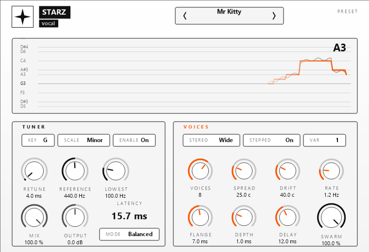
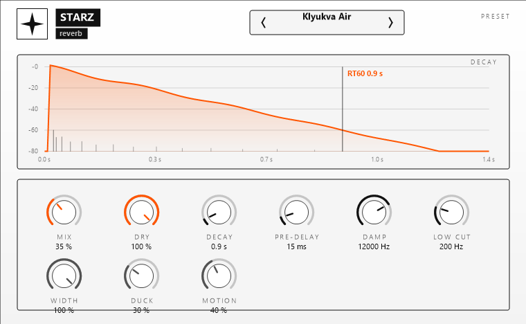
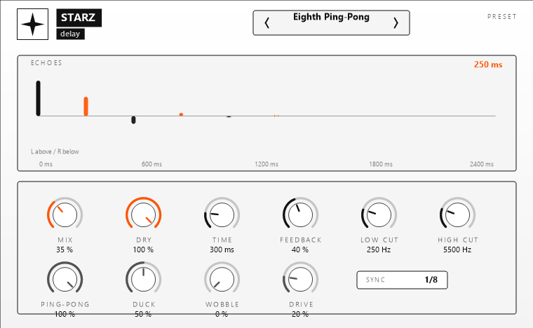

<h1 align="center">STARZ plugins</h1>

<p align="center"><b>Vocal tools for FL Studio: auto-tune, swarm of voices, reverb and delay.</b><br>
Три VST3-плагина для вокала. Windows сейчас, macOS в работе.</p>

<p align="center"></p>

## Что внутри

| Плагин | Что делает |
|---|---|
| **Starz Vocal** | Автотюн в реальном времени с низкой задержкой и рой голосов (до 24) для эффекта «mr kitty». |
| **Starz Reverb** | Яркий широкий реверб, хвост приглушается под голосом. 8 пресетов. |
| **Starz Delay** | Стерео пинг-понг, синхронизация с темпом проекта. 8 пресетов. |

<p align="center"> </p>

## Установка

### Windows (FL Studio)
1. Закрой FL Studio.
2. Скачай репозиторий (**Code → Download ZIP**), распакуй и дважды щёлкни **`install.bat`**. Или одной командой в PowerShell:
   ```powershell
   irm https://raw.githubusercontent.com/nwbmarilyn/starz-plugins/main/install.ps1 | iex
   ```
3. Открой FL: **Options → Manage plugins → Find installed plugins**. Плагины появятся в списке как *Starz Vocal*, *Starz Reverb*, *Starz Delay*.

Без прав администратора: `install.bat -User`. Удалить: `install.bat -Uninstall`.

### macOS
```bash
curl -fsSL https://raw.githubusercontent.com/nwbmarilyn/starz-plugins/main/install.sh | STARZ_REPO=nwbmarilyn/starz-plugins bash
```
Ставит в `~/Library/Audio/Plug-Ins/VST3` (для всех пользователей: добавь `--system`). Затем перезапусти DAW и пересканируй плагины.

> Версия для macOS собирается автоматически (GitHub Actions), но на настоящем Mac пока не проверялась, и собственного окна у неё нет: DAW покажет свой список параметров. Если что-то не запускается, напиши в Issues.

### Если плагин не виден
- Включи сканирование папки VST3 в настройках DAW (Windows: `C:\Program Files\Common Files\VST3`).
- В старом проекте плагин удали и вставь заново: DAW хранит копию предыдущей версии.

## Как пользоваться
- **Тюн:** на канал с голосом поставь *Starz Vocal*, выбери ключ и гамму (Key, Scale). Preset *Auto-Tune Hard* даёт жёсткие ступеньки, *Auto-Tune* помягче.
- **Рой голосов:** preset *Mr Kitty*, ручки Voices и Swarm. Для живого пения режим задержки *Live* или *Balanced*.
- **Совет:** на дублях ставь по плагину на каждый дубль, а не один на всех: один экземпляр тюнит один голос.
- **Реверб и дилей:** ставь после тюна. Для отправки на send выбери пресет *Send Only*.

## Документация
Подробно: [параметры тюна](docs/vocal.md) · [реверб и дилей](docs/reverb-delay.md) · [дизайн](docs/design.md) · [сборка](docs/build.md) · [macOS](docs/mac.md) · [архитектура и правила](docs/architecture.md) · [тесты](docs/testing.md) · [планы](docs/roadmap.md) · [история](docs/changelog.md)

## Для разработчиков
```
src/core      DSP без платформы (engine.h тюн, fx.h реверб и дилей)
src/common    мост плагин ↔ окно, бренд
src/vocal     Starz Vocal      src/fx   Reverb и Delay
tests, tools  замеры и снимки интерфейса      build   сборка (Windows) и CMake (Windows, macOS)
```
Windows: `powershell -File build\build.ps1 -Plugin all`. Любые правки сразу делаются кроссплатформенными, правила в [architecture](docs/architecture.md).
